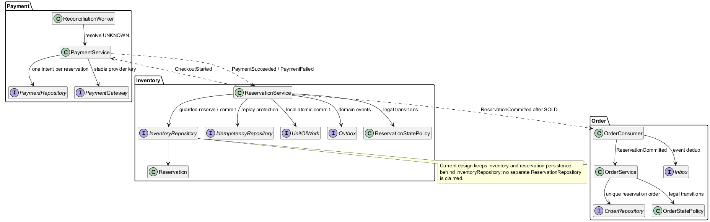

# Simplified jury class diagram

This view isolates the correctness path. `ReservationService` owns the guarded Inventory state change through `InventoryRepository`, idempotency and one `UnitOfWork`; it emits outbox events only after the local commit. `PaymentService` keeps one durable provider intent and its `ReconciliationWorker` resolves uncertainty using that same intent. `OrderConsumer` deduplicates `ReservationCommitted` with `Inbox`, then `OrderService` creates one order per reservation.

`InventoryRepository` is the actual persistence boundary for both inventory quantities and reservations in this design. A separate `ReservationRepository` is intentionally not shown because it would imply an implementation class that the submitted design does not define.

